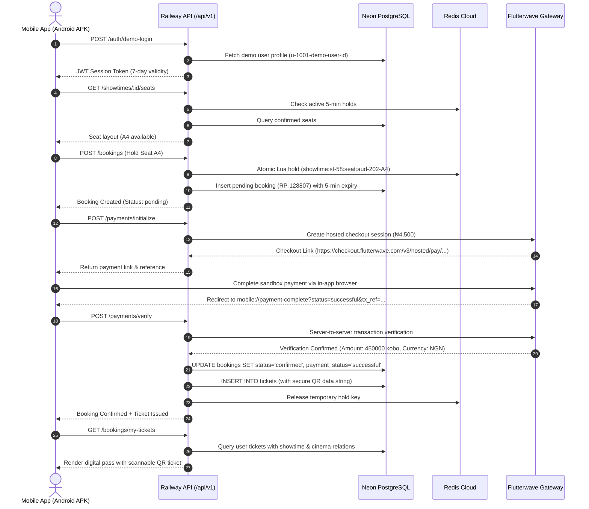

# ReelPass (Matinee) — Cinema Ticket Reservation Platform

[](https://github.com/ScrappyAT/Reelpass)
[-brightgreen?style=flat&logo=expo)](https://expo.dev/accounts/scrappy4rl/projects/reelpass/builds/d5df0b9c-4f0e-4c5f-a8b5-a9612ff3ae1c)
[](https://www.typescriptlang.org/)
[-black?style=flat&logo=expo)](https://expo.dev/)
[](https://nodejs.org/)
[%20%2B%20Redis%20Cloud-informational?style=flat&logo=postgresql)](https://neon.tech/)

> **ReelPass** — *Your seat. Your story.*  
> A full-stack cinema ticket reservation and digital ticketing application designed for the Nigerian cinema market. Built as an **npm workspaces monorepo** featuring an **Expo React Native mobile client**, a **Node.js/Express REST API**, **PostgreSQL** for relational persistence, **Redis** for atomic seat holds, and **Flutterwave Standard Checkout** for payment processing.

---

## 📱 Final Tested Android Build

The standalone Android APK has been verified end-to-end on a physical device, covering user authentication, seat selection, real-time seat locks, Flutterwave sandbox checkout, deep-link return navigation, payment reconciliation, digital ticket retrieval, and scannable QR pass generation.

- **Download Tested Android APK**: [EAS Build `d5df0b9c-4f0e-4c5f-a8b5-a9612ff3ae1c`](https://expo.dev/accounts/scrappy4rl/projects/reelpass/builds/d5df0b9c-4f0e-4c5f-a8b5-a9612ff3ae1c)
- **Git Commit Reference**: `f55ce71` (Tested Android build code) / `a198fb8` (Submission release)
- **EAS Build ID**: `d5df0b9c-4f0e-4c5f-a8b5-a9612ff3ae1c`
- **iOS Demonstration**: Demonstrated via **Expo Go** and Metro bundler during development; not published as a standalone App Store / IPA release.

---

## 📌 Demonstration & Sandbox Notices

1. **Payment Gateway**: All transactions are processed through **Flutterwave Sandbox** in test mode. No real bank accounts, debit cards, or monetary funds are debited.
2. **Catalog & Cinema Data**: Cinema locations (Lagos, Abuja, Port Harcourt, Ibadan), auditoriums, showtimes, and seat layouts are **demonstration fixtures** created for product evaluation. Movie details are integrated with TMDB with offline fallback caching.
3. **Currency & Prices**: Prices are denominated in **Nigerian Naira (₦ / NGN)** and stored internally as integer kobo on the backend.

---

## 🚀 Live Cloud Infrastructure

The application is deployed to production cloud infrastructure:

| Component | Provider / Service | Details / Endpoint |
|---|---|---|
| **API Server** | **Railway** | Production URL: `https://matineeapi-production.up.railway.app/api/v1` |
| **Relational Database** | **Neon PostgreSQL** | Serverless PostgreSQL 16 with connection pooling and strict unique constraints |
| **In-Memory Cache** | **Redis Cloud** | Managed Redis 7 instance executing atomic Lua seat-hold acquisition with 5-minute TTL |
| **Payment Gateway** | **Flutterwave v3** | Hosted standard checkout, server-side verification API, and webhook signature validation |
| **Movie Metadata** | **TMDB API** | Live movie details, posters, and backdrops with offline fallbacks |
| **Mobile Client** | **Expo / EAS** | React Native Android preview APK with hermes bytecode bundle |

---

## ✨ Verified End-to-End User Journey (Booking `RP-128807`)

The entire reservation and payment lifecycle was validated on the physical Android APK against the live cloud backend:



### Verified Transaction Evidence
- **Booking Reference**: `RP-128807` (`id: bk-1793015322940-505`)
- **Movie**: *Oppenheimer* (Auditorium 2 — Dolby Atmos Soundstage)
- **Cinema**: *ReelPass Cinemas Lekki*, Lagos
- **Seat Reserved**: `A4` (Standard Tier)
- **Total Paid**: `₦4,500.00` (`450000` integer kobo)
- **Payment Reference**: `FLW-RP-128807-1793015337858`
- **QR Pass Code**: `REELPASS-BOOKING-RP-128807` / `REELPASS-TKT-A4-RP-128807`

---

## 🛠️ Key Engineering Solutions & Fixes

### 1. Concurrency-Safe Booking Engine
- **Atomic Two-Phase Reservation**: Redis Lua scripts guarantee atomic, all-or-nothing seat hold acquisition with automatic 5-minute TTL expiration.
- **Strict Database Authority**: PostgreSQL transactions with `SELECT ... FOR UPDATE` and unique constraints (`showtime_id, seat_id`) on `booking_seats` and `tickets` prevent double-booking under extreme concurrency.
- **Fail-Closed Verification**: Bookings cannot transition to `confirmed` without server-side validation of amount, currency, and transaction status from Flutterwave.

### 2. Authentication Recovery & Self-Healing Session
- **Cold-Start Resilience**: Standalone Android APKs can encounter 1–2 second network interface startup delays. The mobile client implements a 2-attempt cold-boot retry with backoff during initialization.
- **Proactive Token Guard**: If transient network drops prevent initial login, `ApiClient` automatically acquires a valid session token before dispatching any protected booking or ticket request.
- **401 Auto-Recovery**: If a session expires or returns `UNAUTHORIZED`, the client automatically refreshes the demo session credentials and retries the request seamlessly.

### 3. My Tickets Latency Resilience & In-Flight Locking
- **Database Latency Accommodation**: Multi-relation queries against hosted PostgreSQL on Railway require ~3.8s to resolve 10 historical reservations with full showtimes, seats, and QR codes. The client timeout for database-backed endpoints was increased from 3.5s to 12.0s.
- **In-Flight Request Guard**: Screen focus and lifecycle hooks are protected by an `isFetchingRef` lock, preventing duplicate simultaneous queries from doubling database contention.
- **Automatic Retry & Retry Button**: `MyTicketsScreen` automatically retries temporary connection hiccups twice with backoff and provides an interactive "Retry" button when an operation cannot complete.

---

## 📊 Concurrency & Load Testing

A high-concurrency seat-contention benchmark was conducted using **k6** against the booking engine:

| Metric | Result | Meaning / Interpretation |
|---|---|---|
| **Virtual Users (VUs)** | **500 concurrent VUs** | 50 unique user accounts contending simultaneously |
| **Contested Inventory** | **40 total seats** | High-contention bottleneck scenario |
| **Successful Bookings** | **40 confirmed** | Exactly 100% of available inventory allocated |
| **Expected Conflicts** | **9,155 HTTP 409s** | Correct business rejections; seats held by other users |
| **Double Bookings** | **0 (Zero)** | Mathematically verified across database tables |
| **Server Errors (5xx)** | **0 (Zero)** | Fail-safe error handling under maximum saturation |
| **Network Drops** | **0 (Zero)** | 100% of HTTP connections gracefully handled |
| **Average Latency** | **582 ms** | Mean round-trip under 500-VU load |
| **p95 Latency** | **2,110 ms** | 95th percentile completion time |

> **Environment Distinction**: The 500-VU load test was performed in an isolated, high-throughput containerized environment to stress-test the transactional logic and row locks. Hosted cloud performance on Railway and Neon reflects internet transport latencies and serverless cold-start dynamics. Detailed reports are available in [load-tests/REPORT.md](load-tests/REPORT.md).

---

## 📂 Monorepo Structure

```text
matinee/
├── apps/
│   ├── api/                      # Node.js + Express + TypeScript Backend
│   │   ├── src/
│   │   │   ├── config/           # Zod environment validation
│   │   │   ├── db/               # PostgreSQL pool, schema, migrations, seed, PgStore
│   │   │   ├── middleware/       # Auth guard, error handler, request tracing
│   │   │   ├── redis/            # Redis client & atomic Lua seat-hold scripts
│   │   │   ├── routes/           # Auth, movies, cinemas, showtimes, bookings, payments
│   │   │   ├── services/         # Payment verification, TMDB integration
│   │   │   └── tests/            # Memory tests, PG concurrency tests, Flutterwave tests
│   │   └── package.json
│   │
│   └── mobile/                   # Expo React Native Mobile Client
│       ├── src/
│       │   ├── app/              # Expo Router file-based screens & navigation
│       │   │   ├── (tabs)/       # Home (movies), Search, Tickets, Profile
│       │   │   ├── booking/      # Showtime selection & interactive seat map
│       │   │   ├── payment-complete.tsx # Android deep-link redirect handler
│       │   │   └── gallery.tsx   # Component design system gallery (12 UI states)
│       │   ├── components/ui/    # Theme-aware reusable UI components
│       │   ├── context/          # AuthContext with self-healing token listener
│       │   ├── services/         # Resilient ApiClient with auto-retry
│       │   └── theme/            # Design tokens (colors, typography, radii, spacing)
│       └── package.json
│
├── packages/
│   └── shared/                   # Shared TypeScript models, contracts, & Zod schemas
│       ├── src/
│       │   ├── index.ts
│       │   └── types.ts
│       └── package.json
│
├── docs/                         # Technical documentation & architectural specifications
│   ├── ARCHITECTURE.md           # Full system design, components, and data flows
│   ├── STATE.md                  # Verified operational state & deployment inventory
│   ├── LEARNING-LOG.md           # Engineering log, milestone notes, & reflections
│   ├── SECURITY.md               # Security model, webhook verification, & constraints
│   ├── TRAFFIC.md                # Traffic modeling, load estimation, & scaling analysis
│   ├── SHARDING.md               # Database sharding & horizontal scaling strategy
│   └── COMPONENTS.md             # Mobile design system & component hierarchy
│
├── load-tests/                   # k6 load testing suite
│   ├── scripts/contention.js     # 500-VU seat contention benchmark script
│   ├── REPORT.md                 # Full benchmark report and analysis
│   └── summary.json              # Machine-readable benchmark output
│
├── docker-compose.yml            # Local PostgreSQL 16 + Redis 7 infrastructure
└── package.json                  # Root monorepo workspace configuration
```

---

## 💻 Local Quick Start Guide

### Prerequisites
- **Node.js**: v20.x or v22.x LTS
- **npm**: v10+ (use `npm.cmd` on Windows)
- **Docker Desktop**: For running local PostgreSQL and Redis containers

### 1. Clone & Install Dependencies
```bash
git clone https://github.com/ScrappyAT/Reelpass.git
cd Reelpass
npm install
npm run build:shared
```

### 2. Start Local Database & Redis (Docker)
```bash
docker compose up -d
docker compose ps
```
- PostgreSQL available on `localhost:5455` (user: `reelpass`, db: `reelpass`)
- Redis available on `localhost:6385`

### 3. Configure Environment Variables
Copy `.env.example` to `.env`:
```bash
cp .env.example .env
```
Key defaults in `.env`:
- `DATA_MODE=postgres`
- `PG_PORT=5455`
- `REDIS_PORT=6385`
- `JWT_SECRET=super-secret-jwt-key-for-reelpass-local-dev-min-32-chars`

### 4. Run Migrations & Seed Database
```bash
npm run migrate:pg --workspace=@matinee/api
npm run seed:pg --workspace=@matinee/api
```

### 5. Launch Backend API
```bash
npm run dev --workspace=@matinee/api
```
The API starts on `http://localhost:4000/api/v1`. Verify with:
```bash
curl http://localhost:4000/api/v1/health
```

### 6. Launch Mobile Application
```bash
npm run start --workspace=@matinee/mobile
```
Press `a` to open in an Android Emulator, or scan the QR code with **Expo Go** on an Android or iOS device connected to the same Wi-Fi.

---

## 🧪 Testing Suites

### 1. Unit & Memory Tests (15 tests)
```bash
npm run test --workspace=@matinee/api
```
Validates input schemas, price calculations, cancellation rules, and fallback mechanisms without external dependencies.

### 2. PostgreSQL Concurrency Tests (6 suites)
```bash
npm run test:pg --workspace=@matinee/api
```
Validates transactional row locks, seat hold releases, idempotent confirmations, and constraint enforcement against live PostgreSQL.

### 3. Flutterwave Integration & Payment Verification Tests
```bash
node --import tsx --test apps/api/src/tests/flutterwave.test.ts
```
Validates checkout creation, webhook signature checking (`timingSafeEqual`), replay attacks, and status polling.

### 4. TypeScript Workspace Verification
```bash
npm run typecheck
```
Executes `tsc --noEmit` across `@matinee/shared`, `@matinee/api`, and `@matinee/mobile`.

---

## 📚 Complete Documentation Index

- [System Architecture](docs/ARCHITECTURE.md) — Architectural design, Mermaid flowcharts, and component responsibilities.
- [Current Verified State](docs/STATE.md) — Comprehensive inventory of deployed cloud services, verified features, and testing logs.
- [Learning & Engineering Log](docs/LEARNING-LOG.md) — Project milestones, engineering challenges, problem resolutions, and final reflection.
- [Security & Constraint Architecture](docs/SECURITY.md) — Defensive security principles, token handling, and webhook verification.
- [Traffic & Concurrency Analysis](docs/TRAFFIC.md) — Load testing analysis, traffic models, and capacity planning.
- [Database Sharding Strategy](docs/SHARDING.md) — Strategic plan for horizontal database partitioning across cinema circuits.
- [Mobile Design System](docs/COMPONENTS.md) — Component inventory, design tokens, and state representations.
- [Load Test Report](load-tests/REPORT.md) — Complete 500-VU benchmark results and verification proofs.

---

## ⚖️ License & Attribution

This project is open-source under the MIT License. Film metadata and artwork are provided via the TMDB API under TMDB terms of service (this product uses the TMDB API but is not endorsed or certified by TMDB). Designed and engineered by **ScrappyAT**.