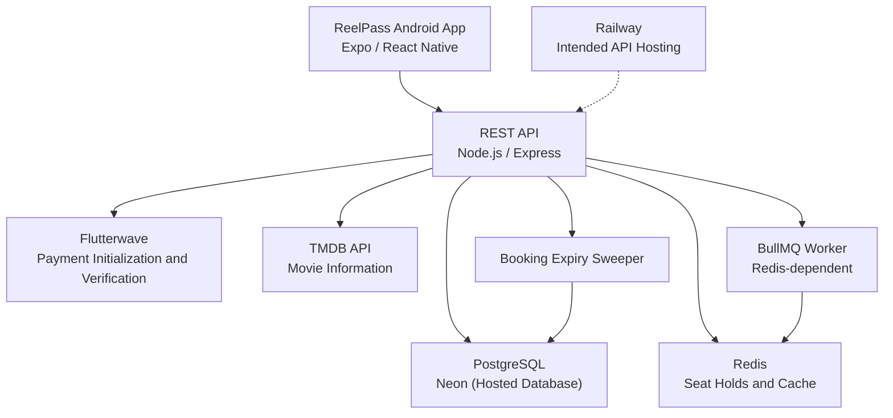
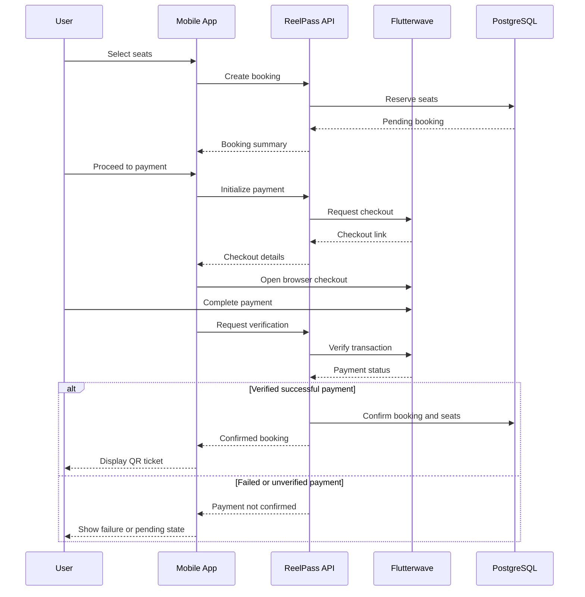

# ReelPass (Matinee) — System Architecture

## 1. System Overview

**ReelPass** is a cinema ticket reservation application developed as a TypeScript monorepo. It provides movie discovery, cinema and showtime selection, interactive seat reservations, Flutterwave payment integration, and digital cinema tickets.

The platform consists of three primary workspaces:

- **`apps/mobile`** — Expo React Native mobile application for Android.
- **`apps/api`** — Node.js, Express, and TypeScript REST API.
- **`packages/shared`** — Shared TypeScript interfaces, data models, and Zod validation schemas.

The backend uses PostgreSQL for persistent records and Redis for temporary seat holds and caching. Flutterwave provides the payment integration, while TMDB supplies movie information when configured.

### Architecture Principles

The system is designed around the following principles:

1. **Database authority:** PostgreSQL is the final source of truth for seat availability and confirmed bookings.
2. **Concurrency safety:** Redis atomic holds, PostgreSQL transactions, and database constraints protect against double-booking.
3. **Server-side validation:** Booking prices, payment verification, and reservation ownership are validated by the backend.
4. **Idempotency:** Repeated requests should not create duplicate bookings or confirmations.
5. **Separation of concerns:** Mobile presentation, API business logic, and persistent storage are maintained separately.
6. **Fail-closed payments:** A booking cannot be confirmed without successful payment verification.

---

## 2. High-Level Architecture



### Component Responsibilities

| Component | Technology | Responsibility |
|---|---|---|
| Mobile application | Expo, React Native, TypeScript | User interface and booking interactions |
| API server | Node.js, Express, TypeScript | Authentication, business rules, bookings, and payments |
| Shared package | TypeScript, Zod | Shared types and request validation |
| Persistent database | PostgreSQL / Neon | Users, movies, cinemas, showtimes, seats, bookings, payments, tickets |
| Cache and seat holds | Redis | Atomic temporary seat reservations and caching |
| Payment gateway | Flutterwave | Payment checkout and transaction verification |
| Movie information | TMDB | Movie catalog information when configured |
| Background processing | Node.js interval, BullMQ | Booking expiry and queue infrastructure |

**Deployment note:** Neon is configured as the hosted PostgreSQL provider. Railway is the intended backend hosting platform, but its availability is currently preventing completion of live deployment verification.

---

## 3. Monorepo Structure

```text
matinee/
├── apps/
│   ├── api/
│   │   ├── src/
│   │   │   ├── config/
│   │   │   ├── db/
│   │   │   ├── middleware/
│   │   │   ├── queue/
│   │   │   ├── redis/
│   │   │   ├── routes/
│   │   │   ├── services/
│   │   │   └── tests/
│   │   └── package.json
│   │
│   └── mobile/
│       └── src/
│           ├── app/
│           ├── components/
│           ├── context/
│           ├── services/
│           └── theme/
│
├── packages/
│   └── shared/
│       └── src/
│
├── docs/
├── load-tests/
├── docker-compose.yml
└── package.json
```

The repository uses npm workspaces to manage its applications and shared package.

---

## 4. Mobile Application Architecture

The Android application is built with Expo React Native and TypeScript.

### Navigation

Expo Router provides file-based navigation.

The main application tabs are:

- **Discover:** Browse available movies.
- **Search:** Search for movies.
- **My Tickets:** View reservations and confirmed digital tickets.
- **Profile:** Access account-related information.

Additional screens support onboarding, authentication, movie details, cinema selection, showtime selection, and interactive seat booking.

### Reusable UI Components

The application includes reusable components under `apps/mobile/src/components/ui/`:

- Button
- Text
- Card
- MovieCard
- Input
- Chip
- Badge
- BottomSheet
- Skeleton
- Toast
- EmptyState
- SeatMap

These components use centralized design tokens for consistent typography, colors, spacing, and other visual properties.

### API Communication

The mobile application communicates with the backend through its API service layer.

Movie and cinema discovery support read-only demo fallbacks when the backend is unavailable. However, authentication-dependent reservations, seat holds, and payment confirmation require backend processing.

The application must not simulate successful reservations or payments when the backend is unreachable.

---

## 5. Data Architecture

### Data Modes

The backend supports three modes through the `DATA_MODE` environment variable.

| Mode | Behavior |
|---|---|
| `postgres` | Requires PostgreSQL; startup fails if the database is unavailable |
| `memory` | Explicit nonpersistent demonstration mode |
| `auto` | Uses PostgreSQL when `DATABASE_URL` is provided; otherwise uses memory mode |

For a hosted environment using Neon, PostgreSQL mode should be used to prevent accidental fallback to nonpersistent demo storage.

### PostgreSQL Database

The canonical initial schema is defined in:

`apps/api/src/db/migrations/001_init.sql`

Flutterwave-related schema changes are defined in:

`apps/api/src/db/migrations/002_flutterwave_payments.sql`

### Core Tables

| Table | Purpose |
|---|---|
| `users` | User accounts and authentication data |
| `movies` | Movie information |
| `cinemas` | Cinema information |
| `auditoriums` | Cinema screening rooms |
| `seats` | Physical seat layouts |
| `showtimes` | Movie screening schedules and pricing |
| `showtime_seats` | Availability of each seat for a specific screening |
| `bookings` | Reservation records and booking statuses |
| `booking_seats` | Seats associated with reservations |
| `tickets` | Digital ticket records |
| `payments` | Flutterwave payment attempts and verification records |

### Financial Data

All ticket prices and booking totals are stored as integer kobo.

**1 Nigerian Naira = 100 kobo.**

This avoids floating-point precision errors in financial calculations.

The backend calculates prices from the showtime's standard and VIP pricing records. Client-supplied totals are not trusted.

---

## 6. PostgreSQL Connection Management

PostgreSQL access uses the `pg` library and connection pooling.

The implementation is located at:

`apps/api/src/db/pool.ts`

### Pool Configuration

The application uses environment-aware defaults:

- **Remote databases, including Neon:** Maximum 20 pooled connections by default.
- **Local PostgreSQL:** Maximum 100 pooled connections by default.
- **`PG_POOL_MAX`:** Overrides the default pool size.
- **Connection timeout:** 30 seconds by default.
- **Idle timeout:** 30 seconds.
- **Statement timeout:** 60 seconds by default.
- **Query timeout:** 60 seconds by default.

Connection pooling reduces the overhead of creating a new database connection for every API request.

### Neon Integration

Neon provides hosted PostgreSQL storage.

The API connects through the `DATABASE_URL` environment variable. TLS handling is supported for remote connections.

For production deployment, the connection string must be stored securely in the hosting platform's environment variables rather than committed to GitHub.

### Transactions and Row Locks

Booking operations use PostgreSQL transactions and `FOR UPDATE` row-level locks.

This prevents competing transactions from modifying the same seat state simultaneously.

Database constraints provide an additional correctness guarantee if Redis is unavailable or multiple API instances receive concurrent requests.

---

## 7. Redis Seat Reservation System

Redis is used for temporary seat holds and caching.

Implementation:

`apps/api/src/redis/seatHolds.ts`

### Seat Hold Key

```text
reelpass:hold:{showtimeId}:{seatId}
```

Each key identifies a seat held for a particular showtime.

The stored value identifies the user holding that seat.

### Atomic Seat Holds

Redis Lua scripts support all-or-nothing seat acquisition.

When a user requests multiple seats:

1. Redis checks whether another user already holds any requested seat.
2. If a conflict exists, the request is rejected.
3. If all seats are eligible, the requested holds are acquired atomically.
4. PostgreSQL independently validates the reservation before recording it.

### Hold Duration

The default hold duration is **300 seconds (5 minutes)**.

It is configurable through:

`SEAT_HOLD_TTL_SECONDS`

### Redis Availability

Redis provides a fast concurrency-control layer, but PostgreSQL remains authoritative.

If Redis is unavailable, the PostgreSQL-backed booking process can continue using transactional locks and database constraints.

This is a database-backed fallback, not an in-memory substitute for confirmed bookings.

---

## 8. Booking Lifecycle

The booking engine manages the reservation process from seat selection through payment confirmation.

### Seat States

```text
AVAILABLE
    |
    v
   HELD
   /  \
  v    v
SOLD  AVAILABLE
      (Expired or Cancelled)
```

- **AVAILABLE:** Seat can be reserved.
- **HELD:** Seat is temporarily reserved while payment is pending.
- **SOLD:** Seat belongs to a confirmed booking.

### Booking States

```text
pending → confirmed
pending → cancelled
pending → expired
```

A booking is only confirmed after successful server-side payment verification.

### Create Booking

Endpoint:

`POST /api/v1/bookings`

Process:

1. Authenticate the user.
2. Validate the booking request with Zod.
3. Attempt Redis seat holds when Redis is available.
4. Start a PostgreSQL transaction.
5. Lock the relevant seat records using `FOR UPDATE`.
6. Check seat availability.
7. Calculate prices on the server.
8. Create the pending booking and associated records.
9. Update seat states to `HELD`.
10. Return the reservation and expiry information.

If another user already holds or owns a seat, the API returns a conflict response, normally HTTP `409`.

### Expiration and Cancellation

Pending bookings expire when their hold period ends.

In PostgreSQL mode, a background expiry sweep runs every **15 seconds** to release stale pending reservations.

Cancellation also releases eligible seat holds.

### Booking Confirmation

After payment verification:

1. The backend validates the payment.
2. The booking status changes to `confirmed`.
3. Payment status changes to successful.
4. The reserved seats become `SOLD`.
5. Temporary Redis holds are cleared.
6. The confirmed booking becomes eligible for QR ticket display.

---

## 9. Flutterwave Payment Architecture

ReelPass integrates Flutterwave through:

`apps/api/src/services/payment.service.ts`

The payment routes are defined in:

`apps/api/src/routes/payment.routes.ts`

### Payment Flow



### Payment Endpoints

| Endpoint | Purpose |
|---|---|
| `GET /api/v1/payments/status` | Payment configuration status |
| `POST /api/v1/payments/initialize` | Initialize Flutterwave checkout |
| `POST /api/v1/payments/verify` | Verify payment and confirm eligible booking |
| `POST /api/v1/payments/webhook` | Receive provider payment notifications |
| `POST /api/v1/bookings/:id/confirm` | Confirm booking after verified payment |

### Payment Verification Rules

The backend checks:

- Transaction status
- Transaction reference or identifier
- Payment amount
- Currency (`NGN`)
- Booking ownership
- Whether the booking has already been confirmed

The backend does not trust the mobile application to declare a payment successful.

### Webhook Security

Flutterwave webhook handling includes signature verification and replay-protection mechanisms.

The backend also validates payment details against the associated booking.

### Fail-Closed Behavior

If payment credentials are missing or a transaction cannot be verified, the backend does not generate a fake successful payment.

Payment-related operations return an appropriate error instead of confirming the booking.

**Verification status:** Flutterwave integration exists in the source code, but successful end-to-end sandbox checkout against the hosted backend has not yet been verified.

---

## 10. Concurrency and Double-Booking Prevention

ReelPass uses multiple layers of protection.

### Layer 1 — Redis

Atomic seat holds reduce competing requests reaching the database.

### Layer 2 — PostgreSQL Row Locks

`FOR UPDATE` serializes transactions competing for the same seat records.

### Layer 3 — Database Constraints

The database enforces uniqueness on:

```text
booking_seats(showtime_id, seat_id)
tickets(showtime_id, seat_id)
```

These constraints prevent duplicate seat assignments.

### Layer 4 — Idempotency

The booking system supports idempotency keys to prevent duplicate reservations caused by request retries.

The database enforces uniqueness for:

```text
bookings(user_id, idempotency_key)
```

### Layer 5 — Payment Verification

A successful payment must be verified before the corresponding booking is confirmed.

Together, these mechanisms reduce race conditions, duplicate bookings, and inconsistent reservation states.

---

## 11. Background Processing

### Booking Expiry Sweeper

The backend runs an expiry sweep every 15 seconds in PostgreSQL mode.

Its purpose is to identify expired pending bookings and release their seats.

### BullMQ Infrastructure

The project includes BullMQ queue and worker infrastructure under:

`apps/api/src/queue/`

The worker starts when Redis is available.

The current worker contains basic job-processing scaffolding. It should not be described as a fully implemented distributed ticket-fulfilment pipeline.

The PostgreSQL expiry sweeper is the implemented mechanism for cleaning up stale bookings.

---

## 12. Authentication and Security

The backend includes authentication middleware and protected routes.

Security-related mechanisms include:

- JWT-based authentication.
- Password hashing.
- Zod request validation.
- Parameterized PostgreSQL queries.
- Booking ownership checks.
- Server-side payment verification.
- Webhook signature verification.
- Idempotency protection.
- Structured API error handling.
- Request identifiers for tracing.

### Environment Secrets

Sensitive configuration must be provided through environment variables.

Examples include:

```text
DATABASE_URL
JWT_SECRET
REDIS_URL
FLUTTERWAVE_SECRET_KEY
FLUTTERWAVE_WEBHOOK_SECRET_HASH
TMDB_API_KEY
```

Production credentials must not be committed to the repository.

---

## 13. API Architecture

The backend exposes versioned REST endpoints under:

`/api/v1`

### Route Groups

| Route | Function |
|---|---|
| `/auth` | Authentication and user access |
| `/movies` | Movie discovery |
| `/cinemas` | Cinema information |
| `/showtimes` | Showtime information and seat maps |
| `/bookings` | Reservations and tickets |
| `/payments` | Payment initialization and verification |
| `/health` | API and infrastructure diagnostics |

### Health Check

Endpoint:

`GET /api/v1/health`

The health endpoint reports application status and available infrastructure diagnostics, including database and cache information.

A successful HTTP response alone should not be treated as proof that every dependent service is operational; the service diagnostics must also be checked.

---

## 14. Performance and Load Testing

ReelPass includes a k6 seat-contention load test.

The test report is located at:

`load-tests/REPORT.md`

The recorded test ran against an isolated local environment using PostgreSQL and Redis.

### Recorded Test Configuration

| Parameter | Value |
|---|---|
| Virtual users | 500 |
| Test duration | 20 seconds |
| Contested seats | 40 |
| Distinct user accounts | 50 |
| Test environment | Local Docker PostgreSQL and Redis |

### Recorded Results

| Metric | Result |
|---|---|
| Successful bookings | 40 |
| Expected seat conflicts | 9,155 |
| Unexpected server errors | 0 |
| Transport drops | 0 |
| Average latency | 581.9 ms |
| 95th-percentile latency | 2,109.9 ms |
| Duplicate booked seats | 0 |
| Duplicate tickets | 0 |

The test demonstrated correct handling of 500 concurrent virtual users competing for a limited seat pool.

**Important:** This is a concurrency-correctness test, not proof that the deployed application sustains 10,000 requests per second.

Detailed load-testing evidence is available in:

- `load-tests/REPORT.md`
- `load-tests/summary.json`
- `load-tests/sql-verification.json`

---

## 15. Deployment Architecture

### Development Environment

Local infrastructure is defined in:

`docker-compose.yml`

The development services include:

- PostgreSQL 16 on host port `5455`.
- Redis 7 on host port `6385`.
- Express API on port `4000` by default.

These are local development settings and are not the public service ports for Neon or Railway.

### Hosted Database

**Neon PostgreSQL** is configured as the hosted persistent database.

The backend uses the configured `DATABASE_URL` to connect to Neon.

### Backend Hosting

**Railway** is the intended backend deployment platform.

The API supports a hosting-provided `PORT` environment variable and listens on `0.0.0.0`.

### Deployment Status

At the time of this documentation update:

- The application code and Android build exist.
- Neon is configured as the PostgreSQL provider.
- Local booking concurrency tests have recorded passing results.
- Railway service availability remains an outstanding deployment issue.
- Live API connectivity and end-to-end Flutterwave sandbox checkout require verification after the backend becomes available.

The application should not be described as fully production-deployed until those checks are completed.

---

## 16. Scalability Considerations

### Current Implementation

The application already includes:

- PostgreSQL connection pooling.
- Redis atomic seat holds.
- Database row-level locking.
- Unique constraints.
- Request idempotency.
- HTTP keep-alive tuning.
- Background booking expiry processing.

### Future Improvements

Potential improvements for larger workloads include:

1. Horizontal scaling of stateless API instances.
2. Managed Redis for distributed seat holds.
3. Database connection pooling appropriate to Neon connection limits.
4. Query optimization and targeted indexes.
5. Load balancing and request-rate controls.
6. Monitoring, metrics, and alerting.
7. Read replicas for read-heavy workloads.
8. Database partitioning or sharding when actual scale justifies it.

**Sharding is a proposed scaling strategy, not a currently deployed feature.**

Further details belong in `SHARDING.md` and `TRAFFIC.md`.

---

## 17. Current Limitations

The following limitations should be acknowledged:

- Cinema locations, showtimes, prices, and seat maps include fictional demonstration data.
- Live payment processing has not yet been validated end-to-end against the hosted backend.
- Railway availability is currently blocking completion of deployment testing.
- Redis-dependent background queue processing is not a fully implemented ticket-fulfilment workflow.
- High-traffic production capacity has not been established by the local 500-VU contention test.
- Database sharding has not been implemented.

These limitations distinguish the implemented graduation project from a production cinema-ticketing service.

---

## 18. Related Documentation

| Document | Purpose |
|---|---|
| `ARCHITECTURE.md` | Overall system architecture |
| `TRAFFIC.md` | Traffic management and load handling |
| `SHARDING.md` | Database partitioning and future sharding strategy |
| `COMPONENTS.md` | Reusable mobile UI components |
| `LEARNING-LOG.md` | Development process and lessons learned |
| `FLUTTERWAVE_INTEGRATION.md` | Payment integration details |
| `PERFORMANCE-REPORT.md` | Performance testing summary |
| `SECURITY.md` | Security considerations |
| `STATE.md` | Technical implementation state |

---

## 19. Conclusion

ReelPass demonstrates a full-stack cinema reservation architecture using Expo React Native, Express, PostgreSQL, Redis, and Flutterwave.

Its central engineering challenge is preventing multiple users from booking the same seat simultaneously.

The implemented solution combines Redis atomic holds, PostgreSQL transactional locks, database uniqueness constraints, idempotent operations, and server-side payment verification.

Local concurrency testing has demonstrated correct seat allocation under a 500-virtual-user workload.

The remaining priorities are restoring hosted backend availability, validating the deployed API, completing Flutterwave sandbox payment testing, and verifying the full Android booking journey.

**Project:** ReelPass (Matinee)  
**Repository:** https://github.com/ScrappyAT/Reelpass  
**Document:** `docs/ARCHITECTURE.md`  
**Last updated:** October 21, 2026
