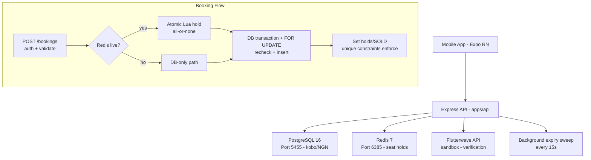

# ReelPass (Matinee) — Architecture

## System Overview

ReelPass is a monorepo cinema booking platform consisting of:
- **apps/api**: Node.js/Express TypeScript backend with PostgreSQL and Redis
- **apps/mobile**: Expo React Native mobile app (preserved as-is)
- **packages/shared**: Shared types and Zod schemas

## Data Architecture

### Modes
The API supports three data modes (configurable via `DATA_MODE` env var):
- `postgres`: Always uses PostgreSQL; fails loudly if unreachable (never falls back)
- `memory`: Explicit in-memory demo mode (fully functional, no persistence)
- `auto`: Uses PostgreSQL if `DATABASE_URL` is set, otherwise memory

### PostgreSQL Schema

The canonical schema lives in `apps/api/src/db/migrations/001_init.sql`. Key tables:
- `users`, `cinemas`, `movies`, `auditoriums`, `seats` — catalog data
- `showtimes` — screening events with NGN pricing in integer kobo (`price_standard_kobo`, `price_vip_kobo`)
- `showtime_seats` — **Authoritative per-showtime seat state** (AVAILABLE/HELD/SOLD). Includes `held_by_user_id` and `hold_expires_at` for distributed hold tracking.
- `bookings` — Reservations with status (pending/confirmed/cancelled/expired), payment_status, idempotency keys
- `booking_seats` — Join table with `UNIQUE(showtime_id, seat_id)` as hard guarantee against double-booking
- `tickets` — Individual seat tickets with `UNIQUE(showtime_id, seat_id)`
- `payments` — Payment records (Flutterwave integration)

**Constraints**: The unique constraints on `(showtime_id, seat_id)` in `booking_seats` and `tickets` are the final authority. Money is stored as INTEGER kobo (1 NGN = 100 kobo). All identifiers are internal string IDs.

### PostgreSQL Access
- Connection pooling via `pg` with configurable `PG_POOL_MAX` (default 100)
- Parameterized queries only
- Transactions with `FOR UPDATE` locking on `showtime_seats` for booking operations
- Idempotent booking support via `bookings(user_id, idempotency_key)` unique constraint

## Redis Seat Holds

Redis provides atomic, cross-instance seat holds (fast path). Implementation: `apps/api/src/redis/seatHolds.ts`

- **Key format**: `reelpass:hold:{showtimeId}:{seatId}` (value = owning userId, TTL in ms)
- **Atomic acquisition**: Lua script acquires all requested seats or none. Returns the first conflicting seat if any is held by a different user.
- **Exclusivity**: A user cannot hold an already-held seat owned by another user. Same user can refresh/own.
- **Expiration**: Self-expiring via Redis TTL (`SEAT_HOLD_TTL_SECONDS`, default 300s)
- **Release**: Only the owner may release their holds (via Lua). Clears on booking confirmation/cancellation.
- **Fallback**: If Redis is unavailable, the system uses PostgreSQL row locks only (logged). No process-local memory for ownership.

## Booking Flow

1. **Create booking (hold)**: `POST /api/v1/bookings`
- Auth required. Validates input via Zod (`createBookingSchema` with internal ID regex)
- If Redis live (Postgres mode): atomically acquire holds; if conflict → 409 with conflict details
- In transaction: lock `showtime_seats` rows (`FOR UPDATE`), check availability (not SOLD; if HELD, must be expired or owned by same user), compute totals server-side from showtime prices, insert booking/booking_seats/tickets, set `showtime_seats` to HELD
- Returns booking with NGN prices (integer kobo). On DB conflict (unique violation) → 409 SEAT_UNAVAILABLE

2. **Confirm booking**: `POST /api/v1/bookings/:id/confirm`
- Requires verified payment (Flutterwave). Verifies amount (kobo), currency (NGN), transaction reference, ownership
- Idempotent: if already confirmed, returns as-is
- Sets booking to confirmed, payment successful, marks `showtime_seats` as SOLD, clears Redis holds

3. **Cancel/expire**: Cancel releases holds; background sweep (15s interval in PG mode) expires stale pending bookings and frees seats.

**Seat lifecycle**: `AVAILABLE → HELD (Redis + DB) → SOLD (confirmed)`; `HELD → AVAILABLE` on expiry/cancellation. PostgreSQL remains the durable authority.

## Payment Integration

**Flutterwave** (sandbox interface): `apps/api/src/services/payment.service.ts`
- No hardcoded success. If `FLUTTERWAVE_SECRET_KEY` unset → `isPaymentConfigured()` false; confirm/init endpoints fail with 503 (no fake success)
- Server-side verification: verify by transaction ID or tx_ref via Flutterwave API; checks status, currency (NGN), amount in kobo matches booking total
- Webhook: requires `FLUTTERWAVE_WEBHOOK_SECRET_HASH`; verifies signature via constant-time comparison; processes only successful events; idempotent (already-processed payments ignored); validates amount/currency against booking

## Price Consistency

- All prices stored as integer kobo (NGN)
- Totals calculated **server-side only** from `showtimes.price_standard_kobo` / `price_vip_kobo` based on seat type
- `booking.seats[].price` reflects the actual showtime-specific price (kobo) — consistent with `totalAmount` and `tickets[].price`
- Client-supplied prices are never trusted (stripped/ignored)

## Concurrency Guarantees

1. **Redis** provides atomic multi-seat hold (all-or-nothing) preventing cross-process race for the fast path
2. **PostgreSQL `FOR UPDATE`** serializes competing transactions on seat rows
3. **Unique constraints**: `booking_seats(showtime_id, seat_id)` and `tickets(showtime_id, seat_id)` are the final hard barrier against duplicate confirmed bookings
4. **Idempotency**: `bookings(user_id, idempotency_key)` prevents duplicate inserts on retries

## Architecture Diagram

## Non-Functional

- Connection pooling sized for 500-VU load (PG_POOL_MAX configurable)
- Statement/query timeouts prevent hung connections
- Keep-alive tuned on HTTP server
- Fail-closed: never simulates payment success; never silently falls back to memory when PG explicitly required
- Reproducible migrations (forward-only, idempotent) and seed from canonical demo catalog