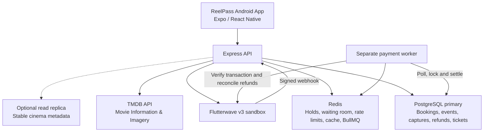
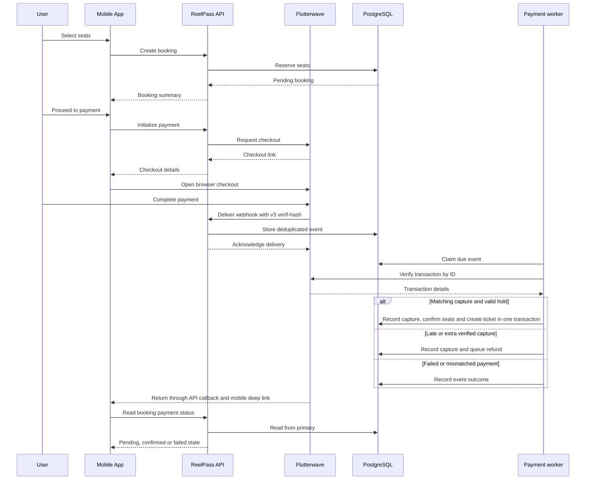

# ReelPass (Matinee) — System Architecture

> This document includes October release evidence. For the current branch and verification, see [graduation implementation](GRADUATION-IMPLEMENTATION.md).

## 1. System Overview

**ReelPass** is a cinema ticket reservation application developed as a TypeScript monorepo. It provides movie discovery, cinema and showtime selection, interactive seat reservations, Flutterwave payment integration, and digital cinema tickets.

The platform consists of three primary workspaces:

- **`apps/mobile`** — Expo React Native mobile application for Android.
- **`apps/api`** — Node.js, Express, and TypeScript REST API.
- **`packages/shared`** — Shared TypeScript interfaces, data models, and Zod validation schemas.

The backend uses PostgreSQL for persistent records and Redis for temporary seat holds and caching. Flutterwave provides the payment integration, while TMDB supplies movie information when configured.

### Architecture Principles

The system is designed around the following principles:

1. **Database authority:** PostgreSQL is the final source of truth for seat availability and confirmed bookings.
2. **Concurrency safety:** Redis atomic holds, PostgreSQL transactions, and database constraints protect against double-booking.
3. **Server-side validation:** Booking prices, payment verification, and reservation ownership are validated by the backend.
4. **Idempotency:** Repeated requests should not create duplicate bookings or confirmations.
5. **Separation of concerns:** Mobile presentation, API business logic, and persistent storage are maintained separately.
6. **Fail-closed payments:** A booking cannot be confirmed without successful payment verification.

---

## 2. High-Level Architecture



### Component Responsibilities

| Component | Technology | Responsibility |
|---|---|---|
| Mobile application | Expo, React Native, TypeScript | User interface, seat selection, browser checkout, and digital ticket QR passes |
| API server | Node.js, Express, TypeScript | Authentication, bookings, checkout initialization, webhook intake and status reads |
| Shared package | TypeScript, Zod | Shared interfaces, domain models, and request validation schemas |
| Persistent database | PostgreSQL / Neon | Users, movies, cinemas, showtimes, seats, bookings, payments, and tickets |
| Cache and seat holds | Redis Cloud (Redis 7) | Atomic temporary seat holds (Lua script) with 5-minute TTL and caching |
| Payment gateway | Flutterwave Standard v3 (Sandbox) | In-app browser checkout and server-side transaction verification |
| Movie information | TMDB | Movie catalog information with offline high-fidelity demo fallback |
| Background processing | Separate Node.js process, BullMQ | Verified settlement, ticket issuance, hold expiry and refund processing |

The diagram describes the graduation candidate. See the [release checklist](RELEASE-CHECKLIST.md) for the proposed staging topology and the state of hosted verification.

---

## 3. Monorepo Structure

```text
matinee/
├── apps/
│   ├── api/
│   │   ├── src/
│   │   │   ├── config/
│   │   │   ├── db/
│   │   │   ├── middleware/
│   │   │   ├── queue/
│   │   │   ├── redis/
│   │   │   ├── routes/
│   │   │   ├── services/
│   │   │   └── tests/
│   │   └── package.json
│   │
│   └── mobile/
│       └── src/
│           ├── app/
│           ├── components/
│           ├── context/
│           ├── services/
│           └── theme/
│
├── packages/
│   └── shared/
│       └── src/
│
├── docs/
├── load-tests/
├── docker-compose.yml
└── package.json
```

The repository uses npm workspaces to manage its applications and shared package.

---

## 4. Mobile Application Architecture

The Android application is built with Expo React Native and TypeScript.

### Navigation

Expo Router provides file-based navigation.

The main application tabs are:

- **Discover:** Browse available movies.
- **Search:** Search for movies.
- **My Tickets:** View reservations and confirmed digital tickets.
- **Profile:** Access account-related information.

Additional screens support onboarding, authentication, movie details, cinema selection, showtime selection, and interactive seat booking.

### Reusable UI Components

The application includes reusable components under `apps/mobile/src/components/ui/`:

- Button
- Text
- Card
- MovieCard
- Input
- Chip
- Badge
- BottomSheet
- Skeleton
- Toast
- EmptyState
- SeatMap

These components use centralized design tokens for consistent typography, colors, spacing, and other visual properties.

### API Communication

The mobile application communicates with the backend through its API service layer.

Movie and cinema discovery support read-only demo fallbacks when the backend is unavailable. However, authentication-dependent reservations, seat holds, and payment confirmation require backend processing.

The application must not simulate successful reservations or payments when the backend is unreachable.

---

## 5. Data Architecture

### Data Modes

The backend supports three modes through the `DATA_MODE` environment variable.

| Mode | Behavior |
|---|---|
| `postgres` | Requires PostgreSQL; startup fails if the database is unavailable |
| `memory` | Explicit nonpersistent demonstration mode |
| `auto` | Uses PostgreSQL when `DATABASE_URL` is provided; otherwise uses memory mode |

For a hosted environment using Neon, PostgreSQL mode should be used to prevent accidental fallback to nonpersistent demo storage.

### PostgreSQL Database

The canonical initial schema is defined in:

`apps/api/src/db/migrations/001_init.sql`

Flutterwave-related schema changes are defined in:

`apps/api/src/db/migrations/002_flutterwave_payments.sql`

### Core Tables

| Table | Purpose |
|---|---|
| `users` | User accounts and authentication data |
| `movies` | Movie information |
| `cinemas` | Cinema information |
| `auditoriums` | Cinema screening rooms |
| `seats` | Physical seat layouts |
| `showtimes` | Movie screening schedules and pricing |
| `showtime_seats` | Availability of each seat for a specific screening |
| `bookings` | Reservation records and booking statuses |
| `booking_seats` | Seats associated with reservations |
| `tickets` | Digital ticket records |
| `payments` | Flutterwave payment attempts and verification records |

### Financial Data

All ticket prices and booking totals are stored as integer kobo.

**1 Nigerian Naira = 100 kobo.**

This avoids floating-point precision errors in financial calculations.

The backend calculates prices from the showtime's standard and VIP pricing records. Client-supplied totals are not trusted.

---

## 6. PostgreSQL Connection Management

PostgreSQL access uses the `pg` library and connection pooling.

The implementation is located at:

`apps/api/src/db/pool.ts`

### Pool Configuration

The application uses environment-aware defaults:

- **Remote databases, including Neon:** Maximum 20 pooled connections by default.
- **Local PostgreSQL:** Maximum 100 pooled connections by default.
- **`PG_POOL_MAX`:** Overrides the default pool size.
- **Connection timeout:** 30 seconds by default.
- **Idle timeout:** 30 seconds.
- **Statement timeout:** 60 seconds by default.
- **Query timeout:** 60 seconds by default.

Connection pooling reduces the overhead of creating a new database connection for every API request.

### Neon Integration

Neon provides hosted PostgreSQL storage.

The API connects through the `DATABASE_URL` environment variable. TLS handling is supported for remote connections.

For production deployment, the connection string must be stored securely in the hosting platform's environment variables rather than committed to GitHub.

### Transactions and Row Locks

Booking operations use PostgreSQL transactions and `FOR UPDATE` row-level locks.

This prevents competing transactions from modifying the same seat state simultaneously.

Database constraints provide an additional correctness guarantee if Redis is unavailable or multiple API instances receive concurrent requests.

---

## 7. Redis Seat Reservation System

Redis is used for temporary seat holds and caching.

Implementation:

`apps/api/src/redis/seatHolds.ts`

### Seat Hold Key

```text
reelpass:hold:{showtimeId}:{seatId}
```

Each key identifies a seat held for a particular showtime.

The stored value identifies the user holding that seat.

### Atomic Seat Holds

Redis Lua scripts support all-or-nothing seat acquisition.

When a user requests multiple seats:

1. Redis checks whether another user already holds any requested seat.
2. If a conflict exists, the request is rejected.
3. If all seats are eligible, the requested holds are acquired atomically.
4. PostgreSQL independently validates the reservation before recording it.

### Hold Duration

The default hold duration is **300 seconds (5 minutes)**.

It is configurable through:

`SEAT_HOLD_TTL_SECONDS`

### Redis Availability

Redis provides a fast concurrency-control layer, but PostgreSQL remains authoritative.

If Redis is unavailable, the PostgreSQL-backed booking process can continue using transactional locks and database constraints.

This is a database-backed fallback, not an in-memory substitute for confirmed bookings.

---

## 8. Booking Lifecycle

The booking engine manages the reservation process from seat selection through payment confirmation.

### Seat States

```text
AVAILABLE
    |
    v
   HELD
   /  \
  v    v
SOLD  AVAILABLE
      (Expired or Cancelled)
```

- **AVAILABLE:** Seat can be reserved.
- **HELD:** Seat is temporarily reserved while payment is pending.
- **SOLD:** Seat belongs to a confirmed booking.

### Booking States

```text
pending → confirmed
pending → cancelled
pending → expired
```

A booking is only confirmed after successful server-side payment verification.

### Create Booking

Endpoint:

`POST /api/v1/bookings`

Process:

1. Authenticate the user.
2. Validate the booking request with Zod.
3. Attempt Redis seat holds when Redis is available.
4. Start a PostgreSQL transaction.
5. Lock the relevant seat records using `FOR UPDATE`.
6. Check seat availability.
7. Calculate prices on the server.
8. Create the pending booking and associated records.
9. Update seat states to `HELD`.
10. Return the reservation and expiry information.

If another user already holds or owns a seat, the API returns a conflict response, normally HTTP `409`.

### Expiration and Cancellation

Pending bookings expire when their hold period ends.

In PostgreSQL mode, a background expiry sweep runs every **15 seconds** to release stale pending reservations.

Cancellation also releases eligible seat holds.

### Booking Confirmation

After the worker verifies a matching provider event:

1. The backend validates the payment.
2. The booking status changes to `confirmed`.
3. Payment status changes to successful.
4. The reserved seats become `SOLD`.
5. Temporary Redis holds are cleared.
6. The confirmed booking becomes eligible for QR ticket display.

---

## 9. Flutterwave Payment Architecture

ReelPass integrates Flutterwave through:

`apps/api/src/services/payment.service.ts`

The payment routes are defined in:

`apps/api/src/routes/payment.routes.ts`

### Payment Flow



### Payment Endpoints

| Endpoint | Purpose |
|---|---|
| `GET /api/v1/payments/status` | Payment configuration status |
| `POST /api/v1/payments/initialize` | Initialize Flutterwave checkout |
| `POST /api/v1/payments/verify` | Read the caller's recorded payment state |
| `GET /api/v1/payments/:bookingId/status` | Poll the caller's recorded payment state |
| `POST /api/v1/payments/webhook` | Authenticate and persist provider notifications |
| `POST /api/v1/bookings/:id/confirm` | Read the caller's recorded booking state through the legacy route |

### Payment Verification Rules

The worker checks:

- Transaction status
- Transaction identifier and reference
- Payment amount
- Currency (`NGN`)
- Booking ownership
- Whether the booking has already been confirmed

The backend does not trust the mobile application to declare a payment successful.

### Webhook Security

Flutterwave webhook handling includes signature verification and replay-protection mechanisms.

The backend also validates payment details against the associated booking.

### Fail-Closed Behavior

If payment credentials are missing or a transaction cannot be verified, the backend does not generate a fake successful payment.

Payment-related operations return an appropriate error instead of confirming the booking.

The graduation candidate passed local tests with mocked provider responses. Its hosted sandbox run is pending.

---

## 10. Concurrency and Double-Booking Prevention

ReelPass uses multiple layers of protection.

### Layer 1 — Redis

Atomic seat holds reduce competing requests reaching the database.

### Layer 2 — PostgreSQL Row Locks

`FOR UPDATE` serializes transactions competing for the same seat records.

### Layer 3 — Database Constraints

The database enforces uniqueness on:

```text
booking_seats(showtime_id, seat_id)
tickets(showtime_id, seat_id)
```

These constraints prevent duplicate seat assignments.

### Layer 4 — Idempotency

The booking system supports idempotency keys to prevent duplicate reservations caused by request retries.

The database enforces uniqueness for:

```text
bookings(user_id, idempotency_key)
```

### Layer 5 — Payment Verification

A successful payment must be verified before the corresponding booking is confirmed.

Together, these mechanisms reduce race conditions, duplicate bookings, and inconsistent reservation states.

---

## 11. Background Processing

Run `npm run start:worker --workspace=@matinee/api` after building and applying the reviewed schema. A BullMQ scheduler checks for due work every two seconds. PostgreSQL stores webhook events, retry times, payment captures and refund ledger entries so a process restart can resume pending work.

The worker expires pending bookings and releases their inventory. A cancelled screening or an extra verified capture can create one refund intent per provider transaction. A fenced, ambiguous refund submission goes through provider reconciliation and can require manual review.

---

## 12. Authentication and Security

The backend includes authentication middleware and protected routes.

Security-related mechanisms include:

- JWT-based authentication.
- Password hashing.
- Zod request validation.
- Parameterized PostgreSQL queries.
- Booking ownership checks.
- Server-side payment verification.
- Webhook signature verification.
- Idempotency protection.
- Structured API error handling.
- Request identifiers for tracing.

### Environment Secrets

Sensitive configuration must be provided through environment variables.

Examples include:

```text
DATABASE_URL
JWT_SECRET
REDIS_URL
FLUTTERWAVE_SECRET_KEY
FLUTTERWAVE_WEBHOOK_SECRET_HASH
TMDB_API_KEY
```

Production credentials must not be committed to the repository.

---

## 13. API Architecture

The backend exposes versioned REST endpoints under:

`/api/v1`

### Route Groups

| Route | Function |
|---|---|
| `/auth` | Authentication and user access |
| `/movies` | Movie discovery |
| `/cinemas` | Cinema information |
| `/showtimes` | Showtime information and seat maps |
| `/bookings` | Reservations and tickets |
| `/payments` | Payment initialization and verification |
| `/health` | API and infrastructure diagnostics |

### Health Check

Endpoint:

`GET /api/v1/health`

The health endpoint reports application status and available infrastructure diagnostics, including database and cache information.

A successful HTTP response alone should not be treated as proof that every dependent service is operational; the service diagnostics must also be checked.

---

## 14. Performance and Load Testing

ReelPass includes a k6 seat-contention load test.

The graduation test released 500 distinct virtual users against the same 50 seats in disposable PostgreSQL and Redis. It recorded 50 holds, 450 expected conflicts, zero duplicate seat claims, zero unexpected errors, 1,066.6 ms mean and 1,453.8 ms p95. It measures local seat-hold contention. See the [report](../load-tests/GRADUATION-500X50.md) and [raw result](../load-tests/graduation-500x50-result.json). The earlier 40-seat run remains in the [historical report](../load-tests/REPORT.md).

---

## 15. Deployment Architecture

### Development Environment

Local infrastructure is defined in:

`docker-compose.yml`

The development services include:

- PostgreSQL 16 on host port `5455`.
- Redis 7 on host port `6385`.
- Express API on port `4000` by default.

These are local development settings and are not the public service ports for Neon or Railway.

### Hosted Database

**Neon PostgreSQL** is configured as the hosted persistent database. The backend uses the configured `DATABASE_URL` with connection pooling (`pg`) and SSL enabled.

### Hosted Cache & Seat Holds

**Redis Cloud** provides the managed Redis 7 instance. It executes atomic Lua scripts for temporary seat holds (5-minute TTL) and caches showtimes and cinema metadata.

### Backend Hosting

**Railway** hosts the production Node.js/Express API at:
`https://matineeapi-production.up.railway.app/api/v1`

The API binds to `0.0.0.0` using the environment-provided `PORT` and connects to Neon and Redis Cloud.

### Deployment Status & Physical Verification

The October release has historical hosted and physical-device evidence:

- **Live Infrastructure**: Railway (API), Neon (PostgreSQL), and Redis Cloud (Cache/Holds) are operational.
- **Physical Device Validation**: Verified using Android Preview APK build `d5df0b9c-4f0e-4c5f-a8b5-a9612ff3ae1c`.
- **Audit Booking Record**: Verified reservation `RP-128807` (*Oppenheimer* at *ReelPass Cinemas Lekki*, seat A4, ₦4,500), including Flutterwave sandbox payment, deep-link redirect (`mobile://payment-complete`), server-side verification, ticket issuance, and QR pass rendering.
- **Hardened Client Fixes**: Cold-boot authentication retry, self-healing demo token acquisition, 12-second database timeout, in-flight request locking, and actionable Retry buttons.

The graduation candidate has a separate worker, a disposable migration rehearsal, and a staging APK profile. Its [release checklist](RELEASE-CHECKLIST.md) tracks the hosted and device checks still due.

---

## 16. Scalability & Performance Analysis

### Implemented Controls

The application implements defense-in-depth concurrency controls:

- PostgreSQL connection pooling with tunable limits.
- Redis atomic seat holds executing Lua scripts for all-or-nothing acquisition.
- Database row-level locking (`SELECT ... FOR UPDATE`) during checkout finalization.
- Unique database constraints (`showtime_id, seat_id`) on `booking_seats` and `tickets`.
- Idempotent request handling via unique booking references and transaction IDs.
- HTTP keep-alive connection reuse.
- Background expiry sweep (every 15s) releasing stale holds.

### Performance Testing Distinction

- **Local High-Concurrency Stress Test (k6)**:
  - **500 virtual users (VUs)** contending for **40 contested seats** over 20 seconds.
  - **Results**: 40 successful bookings (100% inventory), 9,155 expected HTTP 409 conflicts, 0 server errors (5xx), 0 double-bookings, 0 dropped requests.
  - Mean latency: 582 ms; p95 latency: 2,110 ms.
- **Hosted Cloud Performance (Railway + Neon)**:
  - Subject to multi-region cloud latency and serverless database cold-start characteristics.
  - Multi-relation queries (such as resolving 10 historical reservations in `GET /bookings/my-tickets`) take ~3.8–4.0s over internet transport. The mobile client allocates a 12.0s timeout to comfortably accommodate cloud latency.

---

## 17. Project Constraints & Disclaimers

The following demonstration boundaries and constraints apply:

1. **Flutterwave Sandbox Mode**: All payment processing operates in Flutterwave's sandbox test environment. No real funds, debit cards, or banking transactions are processed.
2. **Demonstration Catalog Data**: Cinema locations, auditoriums, showtimes, and prices are **fictional sample fixtures** for Nigerian cities (Lagos, Abuja, Port Harcourt, Ibadan). They are not real commercial cinema listings.
3. **iOS Platform Demonstration**: The iOS client was demonstrated using **Expo Go** and the Metro bundler; it is not published as a standalone App Store / IPA release.
4. **Sharding Scope**: Database sharding is documented as an architectural scaling strategy for future multi-circuit growth ([SHARDING.md](SHARDING.md)), not an active feature of the single-cluster Neon PostgreSQL database.

---

## 18. Related Documentation Index

| Document | Purpose & Scope |
|---|---|
| [System Architecture](ARCHITECTURE.md) | Full system design, components, and data flows |
| [Current Verified State](STATE.md) | Technical implementation state, deployment inventory, and verification logs |
| [Learning & Engineering Log](LEARNING-LOG.md) | Development process, milestones, lessons, and submission reflection |
| [Security Architecture](SECURITY.md) | Security model, webhook verification, and defensive constraints |
| [Traffic & Concurrency Analysis](TRAFFIC.md) | Traffic modeling, k6 benchmark analysis, and capacity estimation |
| [Database Sharding Strategy](SHARDING.md) | Architectural proposal for horizontal database partitioning |
| [Mobile Design System](COMPONENTS.md) | Reusable mobile UI components, design tokens, and state representations |
| [Payment Integration Specs](FLUTTERWAVE_INTEGRATION.md) | Flutterwave Standard Checkout v3 integration details |
| [500-VU Load Test Report](../load-tests/REPORT.md) | High-concurrency seat-contention benchmark report and proofs |

---

## 19. Conclusion

ReelPass demonstrates a complete, production-style cinema reservation architecture built with Expo React Native, Express, PostgreSQL, Redis, and Flutterwave.

Its central engineering objective—preventing double-booking while delivering a seamless mobile reservation and payment experience—has been achieved through atomic Redis holds, PostgreSQL row-level locks, strict database constraints, server-side payment verification, and hardened client-side self-healing.

Local verification covers the graduation candidate's payment worker and seat contention. Hosted and physical-device results above belong to the October build.

**Project:** ReelPass (Matinee)  
**Repository:** https://github.com/ScrappyAT/Reelpass  
**Document:** `docs/ARCHITECTURE.md`  
**Last updated:** 11 November 2026
